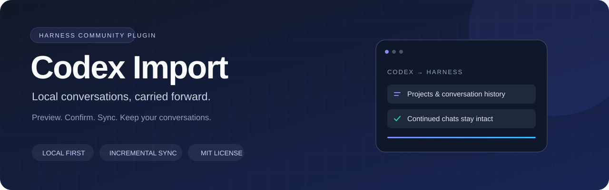

<p align="center"></p>

# Codex Import for DeepSeek Harness

[简体中文](README.md) · English · [Usage guide (Chinese)](docs/USAGE.md) · [Changelog](CHANGELOG.md)

Import local Codex projects and conversations into **native Harness sessions**, then append later changes without replacing conversations continued in Harness.

The current source also supports ChatGPT export ZIPs and extracted directories, including sharded conversations, selected branches, images, files, audio files and transcripts. See [ChatGPT import](docs/USAGE.md#chatgpt-导出包导入). The v0.13.1 release also fixes exported layout and citation markers; existing imported chats display correctly after upgrading without reimporting.

**Compatibility:** DeepSeek Harness **0.2.2-rc.1**, Node.js **24.9+**. Other Harness versions require compatibility testing. This is an independent community plugin, not affiliated with OpenAI or DeepSeek.

## Features

- A single sidebar folder with original project groups, searchable conversation titles and archive filters.
- Preview and explicit confirmation before importing or synchronizing.
- Incremental, append-only updates to existing sessions; continued Harness chats and custom titles are retained.
- Native image previews and file attachments, with deduplicated counts, missing reasons and detailed reports.
- Collapsible terminal/tool history, image-generation prompts, structured question replies and long user messages.
- Reuse valid original working directories; fall back to a dedicated import directory otherwise.
- Confirmed cleanup limited to proven imported copies, with a choice to retain continued conversations.

## Download and install

**[⬇ Download plugin v0.13.1](https://github.com/jiangtaoxu/dsh-plugin-codex-import/releases/download/v0.13.1/dsh-plugin-codex-import-0.13.1.tgz)** · [All releases and checksums](https://github.com/jiangtaoxu/dsh-plugin-codex-import/releases)

Download `dsh-plugin-codex-import-0.13.1.tgz` from the release **Assets**. GitHub's automatic Source code archives are source snapshots, not installable plugin packages. Prebuilt downloads do not require a local Node.js installation or source build; Harness Desktop supplies its runtime.

<details>
<summary>Developers: build from source</summary>

This project has not been published to npm. Use Node.js 24.9+ to build an installable tarball:

```sh
git clone https://github.com/jiangtaoxu/dsh-plugin-codex-import.git
cd dsh-plugin-codex-import
npm ci
npm pack
```

</details>

In Harness, open **Plugins → Install third-party plugin** and supply the absolute path:

```text
file:/absolute/path/dsh-plugin-codex-import-0.13.1.tgz
```

Enable the plugin and restart if prompted. For macOS Desktop, fully quit Harness before using its bundled CLI:

```sh
'/Applications/DeepSeek Harness.app/Contents/Resources/runtime/cli/bin/dsh' \
  plugin --profile desktop add \
  'file:/absolute/path/dsh-plugin-codex-import-0.13.1.tgz'
```

For the Web/npm edition, use its own CLI and profile:

```sh
dsh plugin --profile web add 'file:/absolute/path/dsh-plugin-codex-import-0.13.1.tgz'
```

## Usage

The v0.13.1 release includes an import wizard. Click **导入对话** in the import panel/sidebar, or run in an ordinary Harness conversation:

```text
/codex-import preview
```

Choose local Codex data or a ChatGPT export. Drop a ZIP or use the file picker, then click **开始预览**. Review the results and click **确认导入** (Confirm import). ZIPs are temporarily staged on the connected dsh instance; conversation and attachment import waits for confirmation. Existing JSON commands and `run`/`sync` remain supported. The UI is currently in Chinese.

| Command | Action |
| --- | --- |
| `/codex-import preview` | Open the source selection wizard; with JSON options, start preview directly |
| `/codex-import sync` | Preview incremental synchronization |
| `/codex-import run` | Preview and confirm import; compatibility alias |
| `/codex-import status` | Reopen the current/latest task |
| `/codex-import cancel` | Stop further processing; retain completed work |
| `/codex-import delete` | Scan imported copies and request deletion confirmation |

Optional JSON filters:

```text
/codex-import sync {"threadIds":["original-codex-thread-id"]}
/codex-import preview {"cwd":"/absolute/path/to/project"}
/codex-import preview {"importAttachments":false}
/codex-import preview {"groupByProject":false}
```

`codexHome` defaults to `CODEX_HOME` or `~/.codex`. Missing working directories fall back to `$DSH_HOME/imports/codex`. See the [complete options](docs/USAGE.md#按项目或会话导入).

## Synchronization and data boundaries

Synchronization is **manual**, not scheduled. Existing sessions are matched by source home, Codex thread ID and destination working directory. New or revised messages are appended; source deletions do not erase imported history. Changing the destination creates a separate copy scope. Existing duplicate snapshots are retained rather than silently merged or removed.

Open/running/locked sessions are deferred instead of duplicated. Preview confirmation freezes the reviewed IDs and targets; later new conversations are left for the next run. Interrupted append transactions can resume when their exact recorded prefix matches.

The importer reads Codex databases and JSONL logs without modifying them. It does not read credentials, call a model or execute historical tools. Recoverable attachments are copied into Harness storage; missing files are reported and remote URLs are not downloaded. Index-only entries cannot recover bodies that are absent locally. If you later continue chatting in Harness, its normal model requests may include the imported history.

Deleting copies never deletes the original Codex data or project files. Imported-only history and additional Harness replies have different retention choices in the deletion dialog.

## Development

```sh
npm ci
npm run build
npm run check
npm test
npm pack --dry-run
```

The current version passed **144 local tests** using temporary fixtures and real Harness persistence, without model calls. See [testing](docs/TESTING.md), [architecture](docs/ARCHITECTURE.md), [contributing](CONTRIBUTING.md) and [security](SECURITY.md).

## License

[MIT](LICENSE) · Maintained by [@jiangtaoxu](https://github.com/jiangtaoxu).
