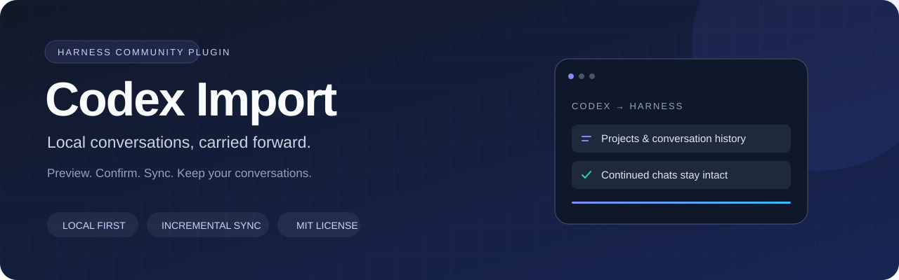
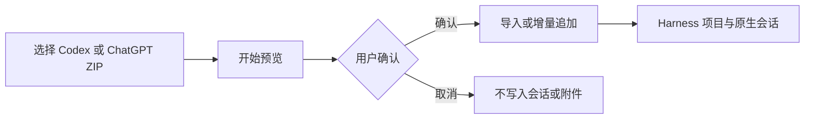

<p align="center">
  
</p>

<p align="center">
  <strong>让 Codex 历史对话，在 Harness 中继续。</strong><br />
  本地导入 · 增量同步 · 项目分组 · 图片附件 · 可折叠历史
</p>

<p align="center">
  <a href="LICENSE"></a>
  
  
  
</p>

<p align="center">
  <a href="https://github.com/jiangtaoxu/dsh-plugin-codex-import/releases/download/v0.13.0/dsh-plugin-codex-import-0.13.0.tgz"><strong>下载插件 v0.13.0</strong></a> · <a href="https://github.com/jiangtaoxu/dsh-plugin-codex-import/releases/latest">最新发布</a><br />
  简体中文 · <a href="README.en.md">English</a> · <a href="docs/USAGE.md">使用手册</a> · <a href="CHANGELOG.md">更新日志</a> · <a href="https://github.com/jiangtaoxu/dsh-plugin-codex-import/issues">反馈问题</a>
</p>

---

**Codex Import** 是 DeepSeek Harness 的第三方插件。它读取本机 Codex 对话，生成可搜索、可打开、可续聊的 Harness 原生会话，并在后续同步时保留你在 Harness 中继续写下的内容。

当前源码另支持 **ChatGPT 导出的 ZIP / 解压目录**，包括分片对话、当前分支、图片、文件、音频文件与转写。使用方式与边界见[ChatGPT 导入](docs/USAGE.md#chatgpt-导出包导入)。v0.13.0 安装包已包含此功能。

> **先预览，确认后写入。** 插件只读 Codex 源数据；不会调用模型、重放历史工具或自动上传对话。之后在 Harness 中主动续聊时，历史会按 Harness 的正常模型请求使用。

## 能做什么

| 功能 | 实际体验 |
| --- | --- |
| 项目与对话收纳 | 左侧统一放入「Codex 导入目录」，内部按原项目分组，直接显示对话标题 |
| 全量搜索 | 搜索标题、项目、路径与原会话 ID，再分页展示，支持归档筛选 |
| 增量同步 | 新对话导入一次，已有会话原位追加新增或修订内容，未变化则跳过 |
| 保留 Harness 续聊 | 不覆盖旧消息与续聊，不自动删除旧版已经生成的多个副本 |
| 图片与文件 | 复制可恢复的本地附件，使用 Harness 原生预览与文件卡片 |
| 附件明细 | 图片和文件分开统计，显示去重数量、引用次数、缺失原因和关联对话 |
| 清爽阅读 | 终端与工具记录、图片提示词默认折叠；结构化问答按问题与回答显示 |
| 长消息显示 | 默认显示部分用户文本，支持展开、收起、字号调整和拖动高度 |
| 工作目录复用 | 原项目目录有效时继续使用该目录，否则回退到导入目录 |
| 可控清理 | 删除前确认，可选择保留续聊，仅清理插件导入的 Harness 副本 |

## 快速开始

### 1. 获取安装包

当前适配 **Harness 0.2.2-rc.1**（运行时 Node.js 24.9+）。下载预构建插件无需自行安装 Node.js 或编译源码；Harness 桌面版自带运行时。建议先备份 Harness 数据，并先选一条会话验证。其他 Harness 版本需重新验证 API 兼容性。

**[⬇ 下载插件 v0.13.0](https://github.com/jiangtaoxu/dsh-plugin-codex-import/releases/download/v0.13.0/dsh-plugin-codex-import-0.13.0.tgz)** · [所有版本与校验文件](https://github.com/jiangtaoxu/dsh-plugin-codex-import/releases)

在 Release 的 **Assets** 中下载 `dsh-plugin-codex-import-0.13.0.tgz`。自动生成的 `Source code (zip/tar.gz)` 是源码归档，不是安装包。

<details>
<summary>开发者：从源码构建</summary>

使用 Node.js 24.9+：

```sh
git clone https://github.com/jiangtaoxu/dsh-plugin-codex-import.git
cd dsh-plugin-codex-import
npm ci
npm pack
```

当前源码构建将生成 `dsh-plugin-codex-import-0.13.0.tgz` 安装包，新增来源选择与 ZIP 拖放向导。不要求 npm 账号；本项目尚未发布到 npm。

</details>

### 2. 安装到 Harness

在 Harness 左侧 **插件 → 安装第三方插件** 中输入安装包的绝对路径；路径有空格时使用 `file:` 前缀：

```text
file:/absolute/path/dsh-plugin-codex-import-0.13.0.tgz
```

启用插件并按提示重启。macOS 桌面版也可在**完全退出应用后**使用它自带的 CLI：

```sh
'/Applications/DeepSeek Harness.app/Contents/Resources/runtime/cli/bin/dsh' \
  plugin --profile desktop add \
  'file:/absolute/path/dsh-plugin-codex-import-0.13.0.tgz'
```

Web/npm 版使用对应安装的 CLI 与 profile：

```sh
dsh plugin --profile web add 'file:/absolute/path/dsh-plugin-codex-import-0.13.0.tgz'
```

桌面版请使用其自带 CLI 管理 `desktop` profile。详见[安装与配置](docs/USAGE.md)。

### 3. 预览并确认

可在导入目录或侧栏点击 **「导入对话」**，也可在 Harness 的普通会话输入框执行：

```text
/codex-import preview
```

在窗口选择 **「本地 Codex」** 或 **「ChatGPT 导出包」**：Codex 可选择自动发现的数据目录；ChatGPT 可拖入 ZIP 或点击选择文件，无需填写路径和 JSON。点击 **「开始预览」**，检查统计后再点击 **「确认导入」**。

文件准备阶段会将 ZIP 暂存在当前 dsh 实例，预览期间不创建导入会话或复制附件。v0.13.0 已包含此向导；带 JSON 参数的兼容命令使用方式仍见[使用手册](docs/USAGE.md)。



## 常用命令

| 命令 | 用途 |
| --- | --- |
| `/codex-import preview` | 打开来源选择向导；带 JSON 参数则直接开始预览 |
| `/codex-import sync` | 增量同步，同样先预览再确认 |
| `/codex-import run` | 兼容入口，同样先预览再确认 |
| `/codex-import status` | 重开当前或最近一次任务的进度窗口 |
| `/codex-import cancel` | 停止后续处理，保留已完成内容 |
| `/codex-import delete` | 扫描导入副本，打开删除前确认窗口 |

只同步指定会话、指定项目或关闭附件复制：

```text
/codex-import sync {"threadIds":["original-codex-thread-id"]}
/codex-import preview {"cwd":"/absolute/path/to/project"}
/codex-import preview {"importAttachments":false}
```

全部选项见[使用手册](docs/USAGE.md#按项目或会话导入)。

## 增量同步会如何处理历史

- **已有副本复用**：同一 Codex 数据目录、原会话 ID、目标工作目录对应同一同步范围。新增消息在日志末尾追加，不覆盖或重排 Harness 续聊。
- **修订与删除**：源端修订作为新版本追加并标明；源端删除不会删除已导入历史。
- **旧版多个副本**：优先选择包含 Harness 续聊的副本；首次增量同步完成后优先沿用该副本，其他旧副本保留。
- **会话被占用**：打开、运行或锁定的会话显示「待重试」，不会因此新建额外副本。
- **范围与确认**：确认锁定预览中的会话和工作目录；预览后新增的对话留待下次。更换目标目录属于不同副本范围。

目前是**手动同步**，不会后台定时扫描。若需要旧版独立快照行为，可使用 `{"syncExisting":false}`。

## 数据边界

| 来源或情况 | 处理方式 |
| --- | --- |
| 本地 SQLite / JSONL 正文 | 转换为 Harness 原生消息，保留原始来源事件 |
| 只有本地索引 | 显示「仅索引／未找到正文」，不虚构消息内容 |
| 可恢复图片与明确文件附件 | 复制到 Harness 附件存储，不再依赖原路径 |
| 缺失文件、损坏图片、远程 URL | 显示原因与明细，不自动下载远程附件 |
| 历史命令与工具调用 | 作为历史记录展示，不重新执行 |
| Codex 凭据 | 不读取 `auth.json` 或其他凭据 |
| 删除导入副本 | 只清理已验证来源的 Harness 会话，Codex 原始记录和项目文件保留 |

**原项目路径决定实际工作目录，侧栏目录决定显示分组。** 原项目不会被移动或复制。导入内容和续聊属于本地敏感数据；反馈问题时请使用脱敏的最小样例。

## 开发与贡献

```sh
npm ci
npm run build
npm run check
npm test
npm pack --dry-run
```

测试使用临时数据库与真正的 Harness 持久化服务，不调用模型。当前版本本地验证 **135 项测试通过**；覆盖增量幂等、续聊保留、附件、断点恢复、清理确认和界面渲染。测试范围与限制见[验证说明](docs/TESTING.md)。

- [使用手册](docs/USAGE.md)：配置、附件、清理、兼容性与故障处理
- [架构说明](docs/ARCHITECTURE.md)：数据流、模块职责和同步边界
- [贡献指南](CONTRIBUTING.md)：开发、测试与问题反馈
- [安全问题](SECURITY.md)：如何避免在公开 Issue 中泄露对话和凭据
- [更新日志](CHANGELOG.md)：版本变化

## 相关项目与许可

基于 [DeepSeek Harness](https://github.com/deepseek-harness/deepseek-harness) 的独立插件机制构建。参考 [Harness 快速开始](https://deepseek-harness.github.io/deepseek-harness/guide/quickstart)、[插件开发文档](https://deepseek-harness.github.io/deepseek-harness/develop/basic/) 与[打包安装说明](https://deepseek-harness.github.io/deepseek-harness/develop/basic/publish)。

[MIT License](LICENSE) · 维护者 [@jiangtaoxu](https://github.com/jiangtaoxu)

本项目为第三方社区插件，与 OpenAI、DeepSeek 无官方隶属关系。
