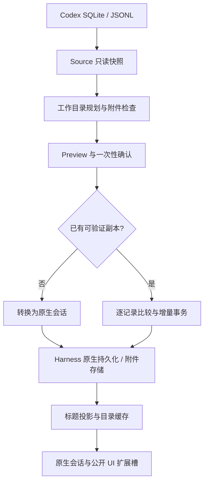

# 架构说明

[← 返回首页](../README.md) · [使用手册](USAGE.md) · [验证说明](TESTING.md)

## 数据流

## 模块职责

| 模块 | 职责 |
| --- | --- |
| `src/source.js`、`jsonl.js` | 发现本地数据库、只读 SQLite、合并 JSONL 补充记录、生成来源摘要 |
| `src/archive.js`、`chatgpt-source.js` | ZIP/目录只读访问、大小/路径/CRC 校验、ChatGPT 分片发现、父节点路径与原始分支保留 |
| `src/import-wizard.js`、`uploads.js` | 来源选择、ZIP 拖放/选择、Codex 目录发现、认证流式暂存、文件编号与生命周期清理 |
| `src/chatgpt-media.js` | ChatGPT 归档附件解析、文件头识别、原生图片与文件保存 |
| `src/chatgpt-format.js`、`chatgpt-presentation.js` | 纯文本富排版整理、明确 ID 引用转换、代码保护，以及委托原生助手组件显示旧导入记录 |
| `src/overlap.js`、`scripts/audit-chatgpt.mjs` | 精确文本重合提示及本机 Codex/dsh 只读对比；不按内容自动合并 |
| `src/destinations.js` | 原项目 / 回退工作目录规划及确认时目录身份校验 |
| `src/media.js` | 明确附件识别、内嵌图片恢复、原生附件准入及复制 |
| `src/convert.js` | 原生消息、轮次、流事件与可忽略来源记录转换 |
| `src/sync.js` | 副本选择、记录级差异、追加式同步及中断恢复 |
| `src/import-plans.js` | 绑定会话、有效期、范围与目标的一次性确认计划 |
| `src/importer.js`、`jobs.js` | 逐会话导入编排、后台任务、进度、取消和结果统计 |
| `src/catalog.js`、`sidebar.js` | 来源校验、冷标题缓存、项目目录与搜索 |
| `src/presentation.js`、`long-messages.js`、`question-replies.js` | 工具 / 图片折叠、长用户文本与结构化问答 |
| `src/attachment-audit.js`、`attachment-details.js` | 附件去重汇总、原因分类、搜索和明细分页 |
| `src/cleanup.js`、`recovery.js`、`identity.js` | 来源证明、受限清理与特定旧版会话恢复 |
| `src/client.js`、`index.js` | 客户端对话框、命令与宿主服务集成 |
| `scripts/build-client.mjs` | 将客户端模块打包为 Harness ModuleLoader 入口 |

`lib/client.js` 是生成产物，使用 Harness 共享的 React 单例。修改客户端源码后执行 `npm run build`，同时提交源码和产物。

## 读取与保存

- 以本机 SQLite 正文为优先展示来源；没有正文时从 JSONL 还原。JSONL 补充历史可保留为原始记录。
- 用户与助手消息转换为 Harness 原生消息；历史工具调用作为文本，不注册可执行工具。
- 使用 `codex-import/source`、`codex-import/raw` 等 `ignorable` 事件保留来源。卸载插件后，原生消息仍可读取。
- 写入使用 Harness 持久化服务与原生锁，不直接改写现有日志文件。
- 标题通过公开投影缓存更新，导入结束后刷新 Session Controller，避免只出现空目录。

## 增量同步边界

原始副本 ID 包含来源命名空间与内容摘要。增量模式在相同来源目录、Codex ID 和目标 cwd 中选择经过来源验证的已有副本，然后保持其 ID，只向末尾追加。

ChatGPT 使用 `chatgpt-` 会话前缀和账户 ID 摘要作为稳定来源，不使用 ZIP 路径作为身份。共享 `codex-import/*` 插件事件命名空间，来源事件通过 `kind:chatgpt`、`sourceId`、`archivePath` 区分；目录、清理、恢复和同步共用身份校验，继续识别旧 Codex 记录。原始节点保存在 `storage:chatgpt` 记录中，`active`/`order` 指示当前路径，分支切换以追加修订处理。ZIP 路径只用于来源说明和保护，预览确认通过完整归档摘要防止替换。

逐条记录保存原始摘要与展示摘要。新增或修订的展示消息进入新轮次，原始事件和 Harness 续聊保持为不可变前缀。源端删除只记录差异，不删除目标消息。自定义 Harness 标题不会被源标题覆盖。

同步先写入带摘要的事务计划，再追加原生事件，最后提交 `codex-import/sync` 状态。中断后校验已有尾部是否与计划完全一致，匹配才继续；冲突时停止写入。恢复计划限制在导入所需事件类型，不执行历史命令。

打开或运行的会话延后；写入时再次取得原生独占锁。取消发生在事务开始后时先完成当前事务，再停止后续会话。预览本身不取得写锁、不复制附件。

## 界面与工作目录

侧栏「Codex 导入目录」是显示分组，header.cwd 是实际工作目录。二者独立：有效原目录可以保留为工作目录，同时在收纳目录中浏览。切回原生侧栏不移动任何会话或项目。

工具历史与长消息折叠通过公开 UI 扩展槽实现，不截断存储内容。附件由 Harness 原生组件显示；问答与普通文本保留消息身份、复制和编辑行为。

## 明确不处理的内容

- 无法恢复本机不存在的正文、图片、文件或原模型内部状态。
- 不将旧子智能体恢复为正在运行的 Harness Agent。
- 不自动跟踪项目改名、目录迁移，不自动合并旧重复副本。
- 不执行模型请求、历史工具、远程附件下载或后台定时同步。
- 清理不会物理回收 Harness 全局共享附件库，以免影响其他会话。
